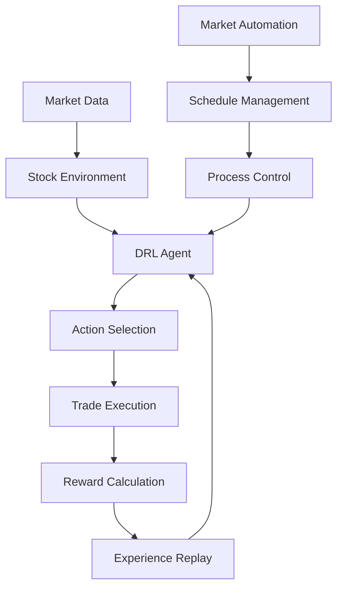

# 🤖 StockBot2 - Intelligent Automated Trading System

[](https://python.org)
[](https://tensorflow.org)
[](LICENSE)
[](https://developer.nvidia.com/cuda-zone)

A sophisticated deep reinforcement learning system for automated stock trading with intelligent market cycle management, GPU acceleration, and comprehensive automation features.

## ✨ Key Features

### 🎯 **Intelligent Automation**

- **Market-Aware Operation**: Automatically detects market hours and adjusts behavior
- **Weekend Training Cycles**: Continuous model improvement during off-hours
- **Friday Optimization**: Hyperparameter tuning after market close
- **Systemd Integration**: Boot-on-startup with automatic restart capabilities

### 🧠 **Advanced AI**

- **Deep Reinforcement Learning**: DDPG (Deep Deterministic Policy Gradients) agent
- **GPU Acceleration**: CUDA-optimized with automatic CPU fallback
- **Experience Replay**: Sophisticated memory management for stable learning
- **Hyperparameter Optimization**: Automated tuning using Optuna

### 📊 **Professional Trading**

- **Live Trading**: Alpaca Markets API integration
- **Paper Trading**: Safe testing environment
- **Multi-Asset Support**: Configurable stock symbol lists
- **Risk Management**: Built-in position limits and safety checks

### 🔧 **Enterprise Features**

- **Comprehensive Logging**: Rotating logs with performance metrics
- **Health Monitoring**: System resource tracking and alerts
- **Clean Code Architecture**: Modular, maintainable design
- **Error Recovery**: Robust failure handling and automatic restart

## 🚀 Quick Start

### Prerequisites

- Python 3.8+ with pip
- CUDA-compatible GPU (optional, CPU supported)
- Alpaca Markets account (for live trading)

### 1. Installation

```bash
# Clone the repository
git clone https://github.com/ProgrammingPro2/StockBot2.0.git
cd StockBot2.0

# Create virtual environment
python3 -m venv .venv
source .venv/bin/activate  # On Windows: .venv\Scripts\activate

# Install dependencies
pip install -r requirements.txt
```

### 2. Configuration

#### Basic Configuration

Edit `config.py` to customize:

- Stock symbols to trade
- Initial balance and risk parameters
- Training hyperparameters

#### API Setup (Optional - for live trading)

Create `.env` file:

```bash
ALPACA_API_KEY=your_alpaca_api_key
ALPACA_SECRET_KEY=your_alpaca_secret_key
ALPACA_PAPER_TRADING=true  # Use paper trading for safety
```

### 3. Quick Test

```bash
# Test the system (safe, no trading)
python3 main.py --mode test --episodes 5

# Train a model (uses historical data only)
python3 main.py --mode train --epochs 50
```

### 4. Full Automation Setup

```bash
# Install as system service (Linux)
chmod +x install_service.sh
./install_service.sh

# Or run manually
python3 market_automation.py
```

## 📖 Usage Guide

### Manual Operations

#### Episode-Based Control (Traditional)

```bash
python3 main.py --mode train --epochs 100          # Train for 100 episodes
python3 main.py --mode optimize --trials 20        # 20 optimization trials
python3 main.py --mode test --episodes 10          # Test for 10 episodes
```

#### Time-Based Control (New!)

```bash
python3 main.py --mode train --time-limit 2.0      # Train for 2 hours
python3 main.py --mode optimize --time-limit 3.0   # Optimize for 3 hours
python3 main.py --mode test --time-limit 0.5       # Test for 30 minutes

# Advanced time controls
python3 main.py --mode train --time-limit 1.5 --max-time 2.0  # Soft 1.5h, hard 2h limit
python3 main.py --mode train --epochs 50 --debug             # Debug training
```

#### Live Trading

```bash
python3 main.py --mode live                        # Start live trading
```

**Time Control Benefits:**

- ✅ **Guaranteed completion** within time windows
- ✅ **Perfect for automation** and scheduling
- ✅ **Prevents overruns** in production environments
- ✅ **Flexible control** with soft and hard limits

#### Intelligent Automation (Enhanced!)

The market automation system now features **intelligent time management**:

```bash
# Start the enhanced automation system
python3 market_automation.py
```

**Smart Features:**

- 🧠 **Intelligent Scheduling**: Automatically calculates remaining weekend time
- ⏰ **Time-Based Decisions**: Uses time limits instead of episode counts when enabled
- 🛡️ **Safety Buffers**: Adds 10% safety margins to prevent overruns
- 📅 **Completion Prediction**: Logs expected completion times
- 🎯 **Weekend Optimization**: Skips training if insufficient time remains
- 📊 **Real-Time Monitoring**: Enhanced status reports with time information

### Market Automation System

The automation system provides hands-off operation with intelligent scheduling:

#### **Market Hours (9:30 AM - 4:00 PM EST)**

- ✅ **Live Trading Active**: Executes trades based on trained model
- 📊 **Real-time Monitoring**: Continuous market data processing
- 🔄 **Portfolio Management**: Automatic position management

#### **Friday After Close**

- 🎯 **Optimization Phase**: 50 hyperparameter trials (~6.7 hours)
- 📈 **Model Improvement**: Find optimal learning parameters
- 🔧 **Performance Tuning**: Enhance trading strategies

#### **Weekends (Saturday-Sunday)**

- 🎓 **Training Sessions**: 8 sessions × 300 episodes each
- ⏱️ **Time Management**: ~26.4 hours total training time
- 🛡️ **Safety Buffer**: 32.4 hours margin (49% of weekend)
- 🎯 **Completion Target**: Finish by Sunday evening

### Configuration Management

#### Automation Settings (`config.py`)

```python
AUTOMATION_CONFIG = {
    # Basic automation settings
    "training_epochs": 300,
    "optimization_trials": 50,
    "live_trading_enabled": True,
    "weekend_intensive_training": True,

    # Time-based automation controls
    "use_time_based_training": True,
    "use_time_based_optimization": True,

    # Practical time limits (hours)
    "training_schedule": {
        "friday_optimization": {
            "time_limit_hours": 6,        # Soft limit
            "max_time_hours": 8           # Hard limit
        },
        "weekend_training": {
            "time_limit_hours": 3,        # Per session
            "max_time_hours": 4,          # Hard limit
            "sessions": 6                 # Max sessions
        }
    },

    # System safety thresholds
    "health_checks": {
        "min_disk_space_gb": 2.0,
        "min_memory_gb": 4.0,
        "max_cpu_usage_percent": 85,
        "max_gpu_memory_percent": 90
    }
}
```

#### Trading Parameters

```python
# Core trading settings
STOCK_SYMBOLS = ["AAPL", "GOOGL", "MSFT", "TSLA", "AMZN"]  # Loaded from stocks.json
INITIAL_BALANCE = 1000.0           # Starting portfolio value
MAX_SHARES_PER_TRADE = 5           # Position size limit
REWARD_SCALING_FACTOR = 0.01       # Learning reward scale

# Neural network hyperparameters
LEARNING_RATE = 0.0001             # Adam optimizer learning rate
BATCH_SIZE = 512                   # Training batch size
MEMORY_SIZE = 50000                # Experience replay buffer size
```

## 🏗️ Architecture

### Core Components

```
StockBot2.0/
├── main.py                     # Main entry point and mode orchestration
├── drl_agent.py               # DDPG reinforcement learning agent
├── stock_env.py               # Trading environment simulation
├── replay_buffer.py           # Experience replay memory management
├── performance_monitor.py     # System performance tracking
├── market_automation.py       # Intelligent automation system
├── alpaca_trade_system.py     # Live trading integration
├── config.py                  # Configuration management
├── utils.py                   # Utility functions
├── noise.py                   # Exploration noise for training
├── install_service.sh         # Service installation script
└── stocks.json                # Stock symbols configuration
```

### Data Flow



## 📊 Monitoring & Analytics

### Real-time Monitoring

```bash
# System logs
tail -f market_automation.log      # Automation system logs
tail -f app.log                    # Application logs

# System status (if running as service)
sudo systemctl status stockbot-automation
sudo journalctl -u stockbot-automation -f
```

### Performance Metrics

The system automatically generates:

- **Training Performance**: `training_performance.png`
- **Test Results**: `test_results.png` and `final_values_distribution.png`
- **Portfolio Tracking**: Real-time portfolio value monitoring
- **GPU Utilization**: Resource usage optimization

### Key Metrics Tracked

| Metric          | Description                     | Target Range           |
| --------------- | ------------------------------- | ---------------------- |
| Episode Reward  | Trading performance per episode | Positive trending      |
| Portfolio Value | Total account value             | > Initial balance      |
| Training Loss   | Actor/Critic network losses     | Decreasing trend       |
| GPU Usage       | Hardware utilization            | 70-90% during training |
| Episode Time    | Processing speed                | < 45 seconds           |

## 🔧 Advanced Configuration

### GPU Optimization

The system automatically detects and optimizes for available hardware:

```python
# Automatic GPU configuration
- Memory growth enabled
- Mixed precision support
- XLA compilation
- Tensor optimization
```

### Custom Stock Lists

Edit `stocks.json` to customize trading symbols:

```json
["AAPL", "GOOGL", "MSFT", "TSLA", "AMZN", "META", "NFLX", "NVDA", "AMD", "INTC"]
```

### Risk Management

Built-in safety features:

- **Position Limits**: Maximum shares per trade
- **Balance Protection**: Prevent oversized positions
- **Market Hours**: Trading only during market hours
- **Paper Trading**: Safe testing environment

## 🚨 Safety & Risk Disclaimer

⚠️ **IMPORTANT**: This software is for educational and research purposes.

### Recommended Safety Practices

1. **Start with Paper Trading**: Always test with `ALPACA_PAPER_TRADING=true`
2. **Small Position Sizes**: Use conservative `MAX_SHARES_PER_TRADE` values
3. **Monitor Closely**: Watch initial performance carefully
4. **Gradual Scaling**: Increase position sizes gradually
5. **Stop Loss**: Implement additional risk management as needed

### Financial Risk Warning

- **Past Performance ≠ Future Results**: Historical data doesn't guarantee future performance
- **Market Risk**: All trading involves risk of loss
- **System Risk**: Technical failures can impact trading
- **Model Risk**: AI decisions may not always be optimal

## 🛠️ Troubleshooting

### Common Issues

| Issue            | Symptoms                   | Solution                             |
| ---------------- | -------------------------- | ------------------------------------ |
| GPU Memory Error | CUDA out of memory         | Reduce `BATCH_SIZE` in config.py     |
| API Connection   | Authentication errors      | Verify `.env` file credentials       |
| Training Slow    | High episode times         | Check GPU drivers, reduce complexity |
| Process Crashes  | Service stops unexpectedly | Check logs, verify dependencies      |

### Debug Mode

Enable detailed logging:

```bash
python3 main.py --mode train --epochs 10 --debug
python3 main.py --mode test --episodes 3 --debug
```

### System Health Check

```bash
# Test basic functionality
python3 main.py --mode test --episodes 1

# Check GPU availability
python3 -c "import tensorflow as tf; print(tf.config.list_physical_devices('GPU'))"

# Verify configuration
python3 -c "from config import *; print('Config loaded successfully')"
```

## 🤝 Contributing

We welcome contributions! Here's how to get started:

1. **Fork the repository**
2. **Create feature branch**: `git checkout -b feature/amazing-feature`
3. **Commit changes**: `git commit -m 'Add amazing feature'`
4. **Push to branch**: `git push origin feature/amazing-feature`
5. **Open Pull Request**

### Development Setup

```bash
# Install dependencies
pip install -r requirements.txt

# Test basic functionality
python3 main.py --mode test --episodes 3
```

## 📄 License

This project is licensed under the MIT License - see the [LICENSE](LICENSE) file for details.

## 🙏 Acknowledgments

- **TensorFlow Team**: For the excellent deep learning framework
- **Alpaca Markets**: For providing accessible trading APIs
- **OpenAI**: For reinforcement learning research and inspiration
- **Community Contributors**: For testing, feedback, and improvements

## 📞 Support

- **Issues**: [GitHub Issues](https://github.com/ProgrammingPro2/StockBot2.0/issues)
- **Discussions**: [GitHub Discussions](https://github.com/ProgrammingPro2/StockBot2.0/discussions)
- **Documentation**: [Wiki](https://github.com/ProgrammingPro2/StockBot2.0/wiki)

---

⭐ **Star this repository if you find it useful!**

**Built with ❤️ for the algorithmic trading community**
